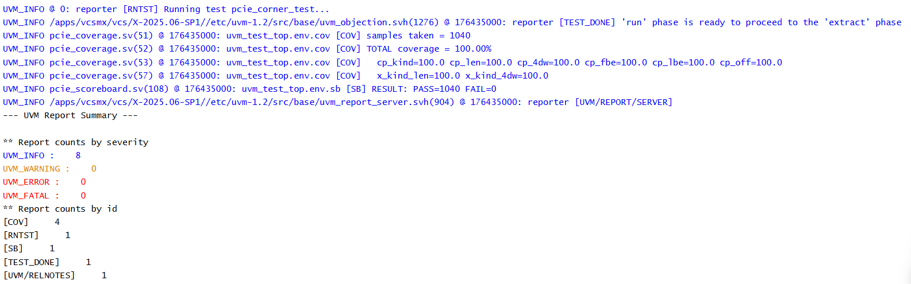
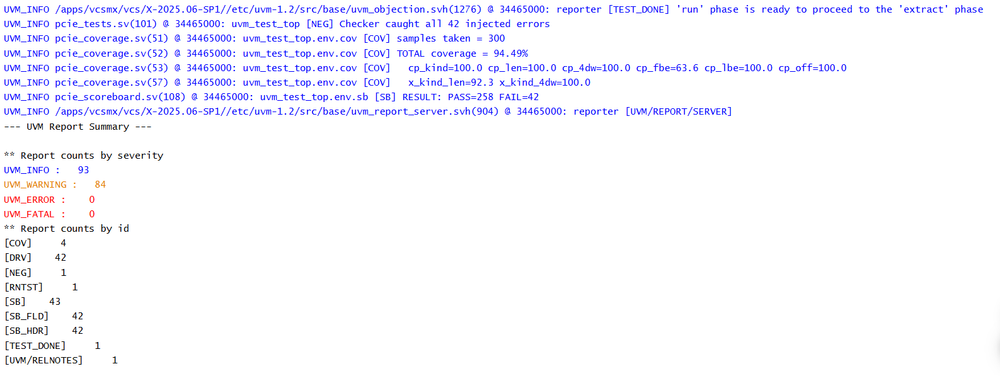
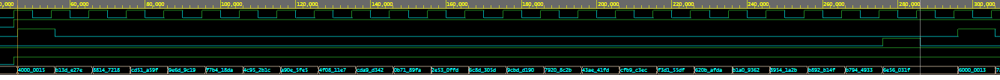

# PCIe TLP Generator & UVM Verification Environment

A SystemVerilog/UVM testbench that generates constrained-random PCIe Transaction Layer Packets (memory read, memory write, completion, completion with data) and checks every header field against an independent golden reference model. It currently runs in loopback (driver -> interface -> monitor), without a DUT.

## Key results

- **Golden model validated** against hand-computed headers for MWr (3DW), MRd (4DW), CplD and Cpl before it judges any traffic.
- **Checker proven to fail:** an error-injection test flips one header bit in every 7th packet, and the scoreboard caught **42 of 42** corruptions (`PASS=258 FAIL=42`).
- **Coverage closure:** constrained-random alone reached **87.09% to 96.77%** over seeds 1 to 10 (about 92% on average). Adding directed corner sequences brought functional coverage to **100% on all 10 seeds**.
- **Clean regression:** 640 packets (corner test) and 300 packets (random test) per seed, 0 UVM_ERROR and 0 UVM_FATAL.

## Architecture

```
Sequence -> Sequencer -> Driver -> pcie_if (loopback) -> Monitor
                           |                                |
                      item sent                       item observed
                           v                                v
                    Scoreboard: golden model -> expected  vs  observed
                                                            Monitor -> Coverage
```

- **pcie_tlp:** sequence item with the TLP fields, legality constraints and header packing.
- **pcie_driver / pcie_monitor:** drive and sample a valid/ready, sop/eop interface, one DW per beat. The monitor decodes only from wire values.
- **pcie_ref_model:** golden encoder written separately from the driver's packing, producing expected raw header DWs and fields.
- **pcie_scoreboard:** compares raw header DWs, decoded fields and payload for each packet.
- **pcie_coverage:** functional covergroup over kind, length, 3DW/4DW, byte enables and 4KB offset.

Packing (driver), decoding (monitor) and encoding (golden model) are three independent implementations, so a bug in one cannot hide on both sides of the comparison.

## Supported TLPs and legality rules

- MRd, MWr, Cpl, CplD, with 32-bit (3DW) and 64-bit (4DW) addressing
- 4KB boundary rule: `(addr[11:0] + length_dw * 4) <= 4096`
- Max payload / max read request limits, and the 1024-DW length encoded as 0
- Legal first/last byte-enable combinations, including single-DW rules

## Tests

| Test | Purpose |
|---|---|
| `pcie_golden_unit_test` | Golden model and header packing vs hand-computed headers |
| `pcie_rand_test` | Weighted constrained-random mix |
| `pcie_corner_test` | Directed corners (4KB edge, max length, byte-enable sweep, completion lengths), then random |
| `pcie_neg_test` | Error injection; checker must catch every corrupted packet |

## Results

| Test | Seeds | Packets / seed | Errors / Fatals | Functional coverage |
|---|---|---|---|---|
| pcie_corner_test | 1 to 10 | 640 | 0 / 0 | **100%** on every seed |
| pcie_rand_test | 1 to 10 | 300 | 0 / 0 | 87.09% to 96.77% |
| pcie_neg_test | default | 300 | 0 / 0 | 42 of 42 injected errors caught |





Why random alone falls short: the 4KB-edge offsets, single-DW byte-enable values and short completions are statistically rare, which is what the directed sequences target.

## How to run (EDA Playground)

- Testbench + Design: SystemVerilog/Verilog, UVM 1.2, Synopsys VCS
- `design.sv` holds the interface; `testbench.sv` holds `tb_top`; the remaining files are included by `pcie_pkg.sv`
- Compile options: `-timescale=1ns/1ps -cm group`
- Run options: `+UVM_TESTNAME=pcie_corner_test +ntb_random_seed=1 -cm group`

## Limitations and next steps

- Loopback only: "observed" means what the monitor sees on the interface, not DUT output
- Completions are single and unsplit; no RCB splitting yet
- No memory model, tag tracking or ordering checks yet
- Next: completion splitting, memory model, tag pool, more error injection, SVA, DUT integration

## Reference

PCI Express Base Specification, Transaction Layer chapter. No specification text or figures are reproduced here.
